# JobVerify

**Is this job actually open? JobVerify checks the official source in real time, scores your odds, and acts on changes before you have to.**

- **Hackathon:** Ground Truth
- **Track:** Live Wire (real-time agents)
- **Sponsor tech:** You.com (Search, Contents, Research APIs) and OpenCrawl (hosted MCP with agent session capture)

## The problem

Job boards are full of ghost postings: listings that were filled or pulled from the company's applicant tracking system (ATS) days ago but still show as live on LinkedIn, Indeed and aggregators. Applicants waste hours on dead links, and miss the genuinely fresh postings, where applying early matters most.

## The solution

Paste any noisy job link (LinkedIn, Indeed, an aggregator, a company page or an ATS URL). JobVerify:

1. **Finds** the canonical posting on the company's real ATS, the third-party mirrors, and breaking company news (**You.com Search / Research**).
2. **Verifies** the live, rendered page: HTTP liveness, soft-404s, an enabled Apply button, `JobPosting` JSON-LD, Ashby's public API, closing language and expiry dates (**OpenCrawl live DOM capture + You.com Contents cross-check**).
3. **Scores** it with a deterministic, explainable rule set. Every point added or removed is a cited receipt tagged with the engine that produced the evidence.
4. **Watches** it. The Live Wire loop re-checks watched jobs, detects state changes, and acts autonomously:
   - **Transition A** (`NEW`/`CLOSED` to `OPEN`, `apply_score >= 85`): promote to the Priority Apply Queue, fire an optional Discord/Slack webhook, and draft a 3-sentence outreach message citing the fresh `publishedAt`.
   - **Transition B** (`OPEN` to `CLOSED`/`GHOST_RISK`): archive the listing and log an alert explaining why, for example *"Official Ashby page now returns HTTP 404; last seen open 12 min ago while the LinkedIn mirror still lists it."*

## Architecture

```mermaid
flowchart LR
  IN["Noisy job URL<br/>or company + role"] --> F

  subgraph F["1. Finder Agent"]
    direction TB
    YS["You.com Search API<br/>canonical ATS URL, LinkedIn mirror snippets,<br/>24-72h company news"]
    YR["You.com Research API<br/>only when hiring status is ambiguous"]
  end

  F -->|FinderOutput| V

  subgraph V["2. Verifier Agent"]
    direction TB
    OC["OpenCrawl hosted MCP<br/>live rendered DOM + agent session capture"]
    YC["You.com Contents API<br/>cross-check / fallback"]
    AS["Ashby public posting API<br/>publishedAt, isListed (no keys)"]
  end

  V -->|VerifierEvidence| S["3. Scorer Agent<br/>deterministic rules + cited receipts<br/>(each tagged You.com or OpenCrawl)"]
  S -->|ScorerVerdict| DB[("SQLite<br/>watched_jobs + event log")]
  DB <--> LW["Live Wire watcher<br/>asyncio loop"]
  LW -->|"Transition A"| PQ["Priority queue + webhook<br/>+ outreach draft"]
  LW -->|"Transition B"| AR["Archive + alert"]
  DB --> API["FastAPI + SSE"] --> UI["Next.js<br/>Command Center"]
```



Plain-text version:

```
 URL / "role at company"
        |
        v
 [1 Finder]   You.com Search (ATS, mirrors, news) + Research (only if ambiguous)
        |
        v
 [2 Verifier] OpenCrawl MCP live DOM (+ session capture) | You.com Contents | Ashby public API
        |
        v
 [3 Scorer]   deterministic score + receipts tagged You.com / OpenCrawl
        |
        v
 SQLite watched_jobs  <-->  Live Wire loop --A--> priority queue + webhook + outreach draft
        |                                  `--B--> archive + alert
        v
 FastAPI (+SSE)  -->  Next.js Command Center
```

### Scoring rules (`backend/agents/scorer.py`)

| Score | Rule |
| --- | --- |
| `open_confidence` | Starts at 100. Drops to **0** on HTTP 404/410, a soft-404 redirect, a passed `validThrough`, or closing phrases ("job no longer available", "position filled", ...). **-40** if the Apply button is missing or disabled on a rendered DOM. |
| `apply_score` | Starts from `open_confidence`. **+15** (cap 100) if published under 48h ago or a mirror says "Be an early applicant". **-35** if posted over 30 days ago with a content hash identical to the stored baseline. **-45** if last-72h news reports layoffs or a hiring freeze. |
| Recommendation | `不建议投递 / Do Not Apply` if `open_confidence` is 0 or `apply_score < 40`; `立即投递 / Apply Immediately` if `apply_score >= 75`, `open_confidence >= 80` and there are no conflicts; otherwise `谨慎投递 / Apply with Caution`. |

> The recommendation thresholds are ours, not from a spec. A job is flagged `GHOST_RISK` when it is open but `apply_score < 70`. Both are constants in `scorer.py`. The Live Wire Priority Queue trigger is separate: `apply_score >= 85` (`PRIORITY_THRESHOLD` in `watcher.py`).

## Repository layout

```
backend/
  main.py            FastAPI app (verify, jobs, poll-now, simulate-event, reset-demo, SSE)
  watcher.py         Live Wire loop + Transition A/B logic
  pipeline.py        Finder -> Verifier -> Scorer orchestration
  agents/            finder.py, verifier.py, scorer.py, common.py
  tools/             you_client.py (Search/Contents/Research), opencrawl_client.py (MCP)
  db.py, actions.py, demo.py, models.py, config.py, logging_config.py
frontend/            Next.js (App Router, TypeScript, Tailwind, Lucide) command center
tests/               offline tests (scorer, DOM parsing, watcher + simulator)
.mcp.json            OpenCrawl + You.com MCP server config (keys via env vars)
```

## Setup

Requirements: Python 3.11+, Node 18.18+ (Node 20+ recommended).

```bash
# 1. Secrets: copy the template and fill in your own keys. .env is git-ignored.
cp .env.example .env

# 2. Backend (from the repo root)
python -m venv .venv && source .venv/bin/activate
pip install -r backend/requirements.txt
uvicorn backend.main:app --reload --port 8000

# 3. Frontend (second terminal)
cd frontend
cp .env.local.example .env.local      # NEXT_PUBLIC_API_BASE=http://localhost:8000
npm install
npm run dev                           # http://localhost:3000
```

Offline tests (no network or keys needed): `pytest -q`

Without API keys the backend still boots, seeds three demo jobs and serves the simulator. Only **Verify Live** and live polling need `YOU_API_KEY` and `OPENCRAWL_API_KEY`. If a key is missing or a service fails, that step is logged and flagged as uncertain rather than crashing the pipeline.

## Demo script (about 3 minutes)

The dashboard loads with 3 seeded jobs. Priority queue and archive counts show in the Watchlist header.

1. **(0:00) Live verify.** Paste a real LinkedIn or Ashby link and press **Verify Live**. Open the right pane: Finder (You.com Search/Research badges), Verifier (OpenCrawl Live DOM badge, Apply button state, `publishedAt`), Scorer (every score step cited).
2. **(1:00) Demo Event Simulator, "Simulate Fresh Ashby Drop".** A closed job flips to `OPEN` with a high score. Watch the feed: status change, **Priority Apply Queue**, webhook, outreach draft citing the publish time.
3. **(1:45) "Simulate Source Closure Conflict".** An open job's official ATS page 404s while the LinkedIn mirror still lists it. It shows `CONFLICT: CLOSED ON ATS`, is archived, and the alert explains why.
4. **(2:25) "Simulate Breaking Hiring Freeze".** News cuts the `apply_score` by 45 and the job goes to `GHOST RISK`, backed by a You.com Research receipt.
5. **(2:50)** Use **Poll All Now** to show the real re-check loop, then **Reset demo data** to run it again.

## What is real and what is simulated

- Seeded watchlist entries are **synthetic snapshots** (marked `DEMO SEED`). They are never live-polled, since their URLs are fictional.
- Simulator events are **injected deltas** (marked `[SIMULATED]` in the feed, alerts and drafts). They run through the real Scorer and Watcher code, so the transitions and autonomous actions are the production code path, but the underlying page change is not a real one.
- **Verify Live** and **Poll All Now** perform real You.com / OpenCrawl calls against real URLs and need valid keys.
- Receipts show which engine produced each fact. Ashby's public posting API and the direct status probe are labelled as direct (not You.com or OpenCrawl).

## Known assumptions to verify before relying on this

- The You.com REST endpoints and response shapes (Search, Contents, Research) in `.env.example` should be checked against You.com's current docs.
- OpenCrawl tool names are discovered at runtime (`python -m backend.tools.opencrawl_client` lists them). The client enables "agent session capture" by passing any boolean capture/trace/record argument the tool exposes; confirm this matches OpenCrawl's real parameter.
- The Finder's company/role parsing of aggregator titles is heuristic; ambiguous input is flagged in `uncertain_fields`.

## Security

No API keys or tokens are in the source. Secrets are read from environment variables (`.env`, git-ignored) and referenced in `.mcp.json` as `${VAR}` placeholders. The Ashby posting API used is public and needs no credentials.
